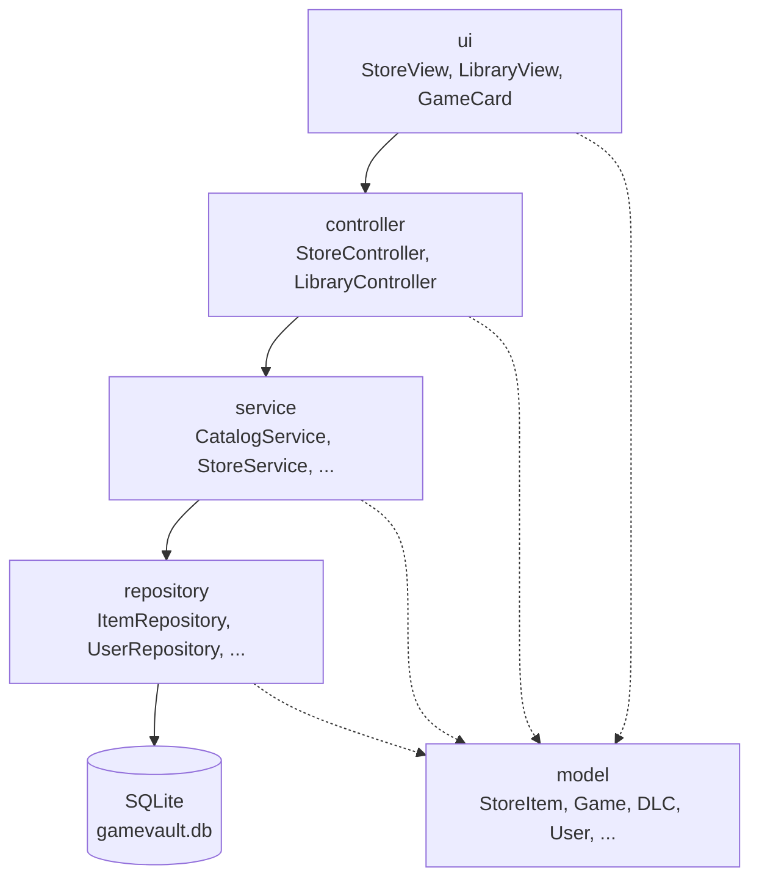
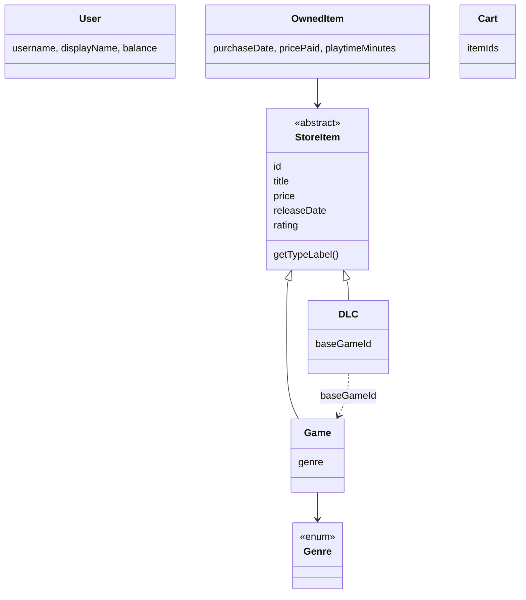
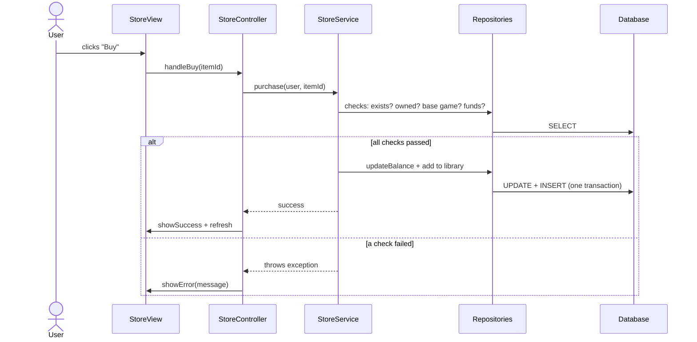
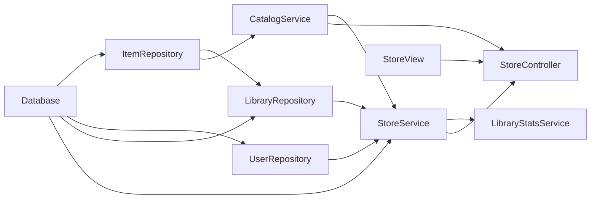
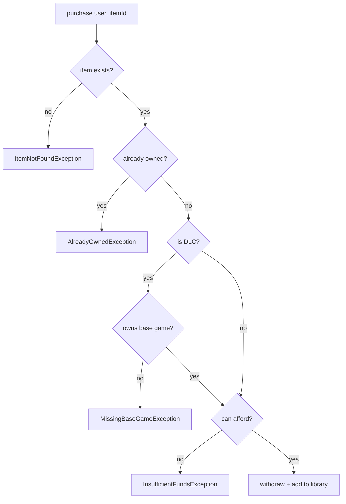
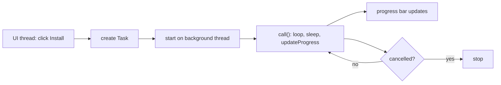
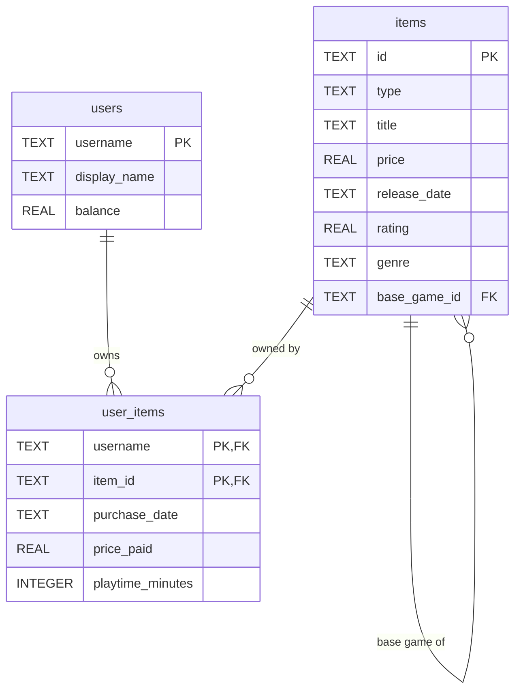
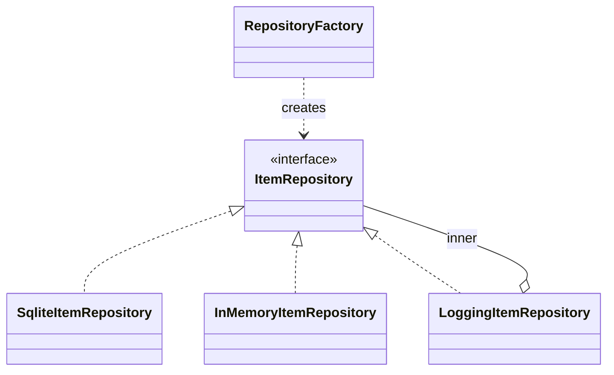

<div dir="rtl" align="right">

# GameVault — מדריך מחלקות מורחב

לכל מחלקה במסמך:

1. **תפקיד** — מה היא עושה במערכת, ולמה היא קיימת.
2. **דוגמה** — איך משתמשים בה בפועל.
3. **תכונות** — השדות שלה.
4. **בנאים** — איך יוצרים אותה, ומה מעבירים לה.
5. **מתודות** — מה אפשר לבקש ממנה, ולמה.

המספר בסוגריים ליד שם המחלקה הוא השלב שבו היא נוצרת. חץ, כמו <code dir="ltr">[3 → 7]</code>, אומר שהמחלקה משתנה בשלב מאוחר יותר.

השמות במסמך הם הצעה. מה שחשוב הוא חלוקת התפקידים.

---

# חלק א׳ — המפה הכללית

## השכבות

המערכת בנויה בשכבות. כל שכבה מדברת רק עם השכבה שמתחתיה.

<div dir="ltr" align="left">



</div>

**חץ רציף:** "קורא ל". **חץ מקווקו:** "משתמש באובייקטים של".

| שכבה | שואלת את עצמה | מותר לה לדבר עם |
|---|---|---|
| <code dir="ltr">ui</code> | איך זה נראה? | <code dir="ltr">controller</code>, <code dir="ltr">model</code> (להצגה בלבד) |
| <code dir="ltr">controller</code> | מה המשתמש ביקש? | <code dir="ltr">service</code>, <code dir="ltr">ui</code>, <code dir="ltr">model</code> |
| <code dir="ltr">service</code> | האם מותר? מה הכלל? | <code dir="ltr">repository</code>, <code dir="ltr">model</code> |
| <code dir="ltr">repository</code> | איך שומרים ושולפים? | המסד, <code dir="ltr">model</code> |
| <code dir="ltr">model</code> | מה הנתונים, והאם הם תקינים? | אף אחד |

**הכלל החשוב:** חץ לעולם לא עולה למעלה. שירות לא יודע שיש מסך. Repository לא יודע שיש שירות.

## מחלקות המודל והקשרים ביניהן

<div dir="ltr" align="left">



</div>

שימו לב: <code dir="ltr">DLC</code> לא מחזיקה הפניה ל־<code dir="ltr">Game</code>, אלא רק את **המזהה** שלו. כך תוספת יכולה להתקיים גם כשמשחק הבסיס לא נטען לזיכרון.

## רכישה מקצה לקצה (משלב 8)

כך עוברת לחיצה על "קנה" בין השכבות:

<div dir="ltr" align="left">



</div>

---

# חלק ב׳ — המחלקות

---

## <code dir="ltr">Main</code> [0 → 5]

### תפקיד

נקודת הכניסה של התוכנית. משלב 5 יש לה תפקיד נוסף וחשוב: **היא המקום היחיד שיוצר את כל האובייקטים הגדולים ומחבר ביניהם.** כל שירות, Repository ומסך נוצר כאן פעם אחת, ומקבל דרך הבנאי את מה שהוא צריך.

### דוגמה

בשלב 3, <code dir="ltr">Main</code> היא מעבדת בדיקה במסוף:

<div dir="ltr" align="left">

```java
CatalogService catalog = new CatalogService();
catalog.addItem(new Game("G1", "Space Run", 49.90, LocalDate.of(2024, 3, 1), 4.5, Genre.ACTION));

User dana = new User("dana", "Dana", 100);
StoreService store = new StoreService(catalog);
store.purchase(dana, "G1");
System.out.println(dana.getBalance());   // 50.1
```

</div>

בשלב 5 ואילך, סדר הבנייה ב־<code dir="ltr">start</code>:

<div dir="ltr" align="left">



</div>

כל חץ פירושו "נכנס לבנאי של". קוראים את התרשים משמאל לימין: אי אפשר ליצור אובייקט לפני שנוצרו כל מה שנכנס אליו.

### מתודות

| מתודה | למה משמשת |
|---|---|
| <code dir="ltr">static void main(String[] args)</code> | שלבים 0–4: בדיקות במסוף. משלב 5: רק <code dir="ltr">launch(args)</code> |
| <code dir="ltr">void start(Stage stage)</code> [5] | JavaFX קוראת לה כשהחלון מוכן. כאן בונים את כל האובייקטים ומציגים את המסך הראשון |

---

# חבילת <code dir="ltr">model</code>

---

## <code dir="ltr">Genre</code> [1]

### תפקיד

רשימה **סגורה** של ז׳אנרים. משתמשים ב־<code dir="ltr">enum</code> ולא במחרוזת, כדי שאי אפשר יהיה לכתוב בטעות <code dir="ltr">"Acton"</code> או <code dir="ltr">"action "</code>. הקומפיילר מכיר את כל הערכים האפשריים.

### דוגמה

<div dir="ltr" align="left">

```java
Game g = new Game(..., Genre.RPG);
if (g.getGenre() == Genre.RPG) { ... }        // == מותר ב־enum
System.out.println(Genre.RPG.getDisplayName()); // "Role-Playing"
```

</div>

### ערכים

<code dir="ltr">ACTION</code>, <code dir="ltr">ADVENTURE</code>, <code dir="ltr">RPG</code>, <code dir="ltr">STRATEGY</code>, <code dir="ltr">SPORTS</code>, <code dir="ltr">PUZZLE</code>, <code dir="ltr">INDIE</code>

### תכונות (אופציונלי)

| תכונה | טיפוס | הסבר |
|---|---|---|
| <code dir="ltr">displayName</code> | <code dir="ltr">String</code> | שם קריא להצגה במסך |

### בנאים

<div dir="ltr" align="left">

```java
Genre(String displayName)
```

</div>

**הסבר:** בנאי של <code dir="ltr">enum</code> הוא תמיד פרטי. לא קוראים לו בעצמנו: Java קוראת לו פעם אחת לכל ערך, כשהמחלקה נטענת. כותבים את הערכים כך: <code dir="ltr">RPG("Role-Playing")</code>.

### מתודות

| מתודה | למה משמשת |
|---|---|
| <code dir="ltr">String getDisplayName()</code> | השם להצגה, במקום שם הקבוע באותיות גדולות |

---

## <code dir="ltr">StoreItem</code> [2] — מחלקה אבסטרקטית

### תפקיד

כל דבר שאפשר לקנות בחנות. היא אבסטרקטית כי בחנות אין "פריט סתם": כל פריט הוא משחק או תוספת. היא מרכזת את מה שמשותף לשניהם, כדי שכל השאר במערכת (הקטלוג, המיון, הרכישה) יוכל לעבוד עם "פריט" בלי לדעת איזה סוג הוא.

### דוגמה

<div dir="ltr" align="left">

```java
List<StoreItem> catalog = List.of(
        new Game("G1", "Space Run", 49.90, ..., Genre.ACTION),
        new DLC("D1", "Space Run: Moon Pack", 19.90, ..., "G1"));

for (StoreItem item : catalog) {
    System.out.println(item.getTypeLabel() + ": " + item.getTitle());
}
// Game: Space Run
// DLC: Space Run: Moon Pack
```

</div>

הלולאה לא יודעת ולא צריכה לדעת מה סוג כל פריט. זה פולימורפיזם.

### תכונות

| תכונה | טיפוס | הסבר |
|---|---|---|
| <code dir="ltr">id</code> | <code dir="ltr">String</code> | מזהה ייחודי. <code dir="ltr">final</code>, לא משתנה לעולם |
| <code dir="ltr">title</code> | <code dir="ltr">String</code> | שם הפריט |
| <code dir="ltr">price</code> | <code dir="ltr">double</code> | מחיר נוכחי. יכול להשתנות במבצע |
| <code dir="ltr">releaseDate</code> | <code dir="ltr">LocalDate</code> | תאריך יציאה |
| <code dir="ltr">rating</code> | <code dir="ltr">double</code> | דירוג בין 0 ל־5 |

### בנאים

<div dir="ltr" align="left">

```java
protected StoreItem(String id, String title, double price,
                    LocalDate releaseDate, double rating)
```

</div>

**למה <code dir="ltr">protected</code>:** אי אפשר ליצור מופע של מחלקה אבסטרקטית ממילא. הבנאי קיים רק כדי שתתי־המחלקות יקראו לו דרך <code dir="ltr">super(...)</code>.

**בודק:** <code dir="ltr">id</code> ו־<code dir="ltr">title</code> לא ריקים, מחיר לא שלילי, דירוג בין 0 ל־5, תאריך לא <code dir="ltr">null</code>. בכל הפרה: <code dir="ltr">IllegalArgumentException</code>.

### מתודות

| מתודה | למה משמשת |
|---|---|
| <code dir="ltr">getId()</code>, <code dir="ltr">getTitle()</code>, <code dir="ltr">getPrice()</code>, <code dir="ltr">getReleaseDate()</code>, <code dir="ltr">getRating()</code> | גישה לנתונים |
| <code dir="ltr">void setPrice(double price)</code> | שינוי מחיר במבצע. עובר אותה בדיקה כמו בבנאי |
| <code dir="ltr">abstract String getTypeLabel()</code> | כל תת־מחלקה מחזירה את התווית שלה: <code dir="ltr">"Game"</code> או <code dir="ltr">"DLC"</code>. המסך משתמש בה בלי <code dir="ltr">instanceof</code> |
| <code dir="ltr">boolean equals(Object o)</code> | שני פריטים שווים אם ורק אם יש להם אותו <code dir="ltr">id</code> |
| <code dir="ltr">int hashCode()</code> | לפי <code dir="ltr">id</code> בלבד, כדי שיתאים ל־<code dir="ltr">equals</code> |
| <code dir="ltr">String toString()</code> | תיאור לבדיקות ולהדפסה |
| <code dir="ltr">int compareTo(StoreItem other)</code> [4] | הסדר הטבעי: לפי <code dir="ltr">id</code>. משמש את <code dir="ltr">Collections.sort</code> בלי Comparator |

---

## <code dir="ltr">Game</code> [1 → 2]

### תפקיד

משחק בחנות. בשלב 1 היא עומדת לבד ומכילה את כל השדות. בשלב 2 היא יורשת מ־<code dir="ltr">StoreItem</code> ומשאירה אצלה רק את מה שייחודי למשחק: הז׳אנר.

### דוגמה

<div dir="ltr" align="left">

```java
Game g = new Game("G1", "Space Run", 49.90,
                  LocalDate.of(2024, 3, 1), 4.5, Genre.ACTION);
g.setPrice(29.90);   // מבצע
```

</div>

### תכונות

| תכונה | טיפוס | הסבר |
|---|---|---|
| <code dir="ltr">genre</code> | <code dir="ltr">Genre</code> | הז׳אנר. כל שאר השדות יורשים מ־<code dir="ltr">StoreItem</code> |

### בנאים

<div dir="ltr" align="left">

```java
Game(String id, String title, double price,
     LocalDate releaseDate, double rating, Genre genre)
```

</div>

קורא ל־<code dir="ltr">super(id, title, price, releaseDate, rating)</code>, ובודק בעצמו רק ש־<code dir="ltr">genre</code> אינו <code dir="ltr">null</code>.

### מתודות

| מתודה | למה משמשת |
|---|---|
| <code dir="ltr">Genre getGenre()</code> | סינון לפי ז׳אנר וסטטיסטיקות |
| <code dir="ltr">String getTypeLabel()</code> | מחזירה <code dir="ltr">"Game"</code> |
| <code dir="ltr">String toString()</code> | <code dir="ltr">super.toString()</code> ועוד הז׳אנר |

---

## <code dir="ltr">DLC</code> [2]

### תפקיד

תוספת למשחק קיים: שלב נוסף, דמות, עונה חדשה. אי אפשר להשתמש בה בלי משחק הבסיס, ולכן היא יודעת למי היא שייכת.

### דוגמה

<div dir="ltr" align="left">

```java
DLC moon = new DLC("D1", "Space Run: Moon Pack", 19.90,
                   LocalDate.of(2024, 9, 1), 4.2, "G1");
```

</div>

כשמשתמש מנסה לקנות את <code dir="ltr">D1</code>, השירות בודק שיש לו את <code dir="ltr">G1</code>.

### תכונות

| תכונה | טיפוס | הסבר |
|---|---|---|
| <code dir="ltr">baseGameId</code> | <code dir="ltr">String</code> | המזהה של משחק הבסיס. מזהה ולא הפניה לאובייקט, כפי שהוסבר במפה |

### בנאים

<div dir="ltr" align="left">

```java
DLC(String id, String title, double price,
    LocalDate releaseDate, double rating, String baseGameId)
```

</div>

**בודק:** <code dir="ltr">baseGameId</code> לא ריק, ושונה מה־<code dir="ltr">id</code> של התוספת עצמה.

**לא בודק:** שמשחק הבסיס קיים. המחלקה לא מכירה את הקטלוג, ולכן הבדיקה הזו שייכת ל־<code dir="ltr">CatalogService</code>.

### מתודות

| מתודה | למה משמשת |
|---|---|
| <code dir="ltr">String getBaseGameId()</code> | בדיקת בעלות על משחק הבסיס לפני רכישה |
| <code dir="ltr">String getTypeLabel()</code> | מחזירה <code dir="ltr">"DLC"</code> |

---

## <code dir="ltr">User</code> [1]

### תפקיד

משתמש בחנות, עם ארנק. היא אחראית על אחד הכללים החשובים במערכת: **היתרה לעולם לא שלילית.** מכיוון שהשדה פרטי ונגיש רק דרך <code dir="ltr">deposit</code> ו־<code dir="ltr">withdraw</code>, אף קוד אחר לא יכול לשבור את הכלל.

### דוגמה

<div dir="ltr" align="left">

```java
User dana = new User("dana", "Dana", 100);
dana.deposit(50);                    // 150
if (dana.canAfford(49.90)) {
    dana.withdraw(49.90);            // 100.1
}
dana.withdraw(500);                  // נכשל, והיתרה נשארת 100.1
```

</div>

### תכונות

| תכונה | טיפוס | הסבר |
|---|---|---|
| <code dir="ltr">username</code> | <code dir="ltr">String</code> | מזהה ייחודי. <code dir="ltr">final</code> |
| <code dir="ltr">displayName</code> | <code dir="ltr">String</code> | השם שמוצג במסך. מותר לשנות |
| <code dir="ltr">balance</code> | <code dir="ltr">double</code> | יתרה בארנק. אין לה setter |

### בנאים

<div dir="ltr" align="left">

```java
User(String username, String displayName, double initialBalance)
```

</div>

**בודק:** שם משתמש לא ריק, יתרה התחלתית לא שלילית.

### מתודות

| מתודה | למה משמשת |
|---|---|
| <code dir="ltr">getUsername()</code>, <code dir="ltr">getDisplayName()</code>, <code dir="ltr">getBalance()</code> | גישה לנתונים |
| <code dir="ltr">void setDisplayName(String name)</code> | שינוי שם תצוגה |
| <code dir="ltr">void deposit(double amount)</code> | הוספת כסף. סכום חייב להיות חיובי |
| <code dir="ltr">void withdraw(double amount)</code> | הורדת כסף. **שלב 1:** <code dir="ltr">IllegalArgumentException</code> אם אין מספיק. **שלב 3:** <code dir="ltr">InsufficientFundsException</code> |
| <code dir="ltr">boolean canAfford(double amount)</code> | בדיקה בלי לשנות כלום. השירות שואל אותה לפני שמתחיל לשנות נתונים |
| <code dir="ltr">equals</code>, <code dir="ltr">hashCode</code> | לפי <code dir="ltr">username</code> |

**למה גם <code dir="ltr">canAfford</code> וגם <code dir="ltr">withdraw</code> בודקת?** <code dir="ltr">canAfford</code> מאפשרת לשאול מראש, לפני שמתחילים לשנות דברים. <code dir="ltr">withdraw</code> בודקת שוב כי היא שומרת על הכלל גם אם מישהו שכח לשאול.

---

## <code dir="ltr">OwnedItem</code> [3]

### תפקיד

פריט **בבעלות** משתמש. זה לא אותו דבר כמו פריט בחנות: יש לו מידע שנוצר רק ברגע הרכישה, ושונה בין משתמשים. לדנה ולאבי יש אותו משחק, אבל תאריכי רכישה, מחירים ששולמו וזמני משחק שונים.

### דוגמה

<div dir="ltr" align="left">

```java
OwnedItem owned = new OwnedItem(spaceRun, LocalDate.now(), 29.90);
owned.addPlaytime(90);
owned.addPlaytime(45);
System.out.println(owned.getPlaytimeMinutes());   // 135
```

</div>

### תכונות

| תכונה | טיפוס | הסבר |
|---|---|---|
| <code dir="ltr">item</code> | <code dir="ltr">StoreItem</code> | הפריט מהחנות. <code dir="ltr">final</code> |
| <code dir="ltr">purchaseDate</code> | <code dir="ltr">LocalDate</code> | מתי נרכש. <code dir="ltr">final</code> |
| <code dir="ltr">pricePaid</code> | <code dir="ltr">double</code> | המחיר ששולם בפועל. <code dir="ltr">final</code> |
| <code dir="ltr">playtimeMinutes</code> | <code dir="ltr">int</code> | זמן משחק מצטבר |

**למה לשמור <code dir="ltr">pricePaid</code> כשיש כבר <code dir="ltr">item.getPrice()</code>?** כי מחיר הפריט בחנות משתנה. אם דנה קנתה ב־49.90 והמשחק ירד ל־29.90, "כמה הוצאתי" חייב להחזיר 49.90.

### בנאים

<div dir="ltr" align="left">

```java
OwnedItem(StoreItem item, LocalDate purchaseDate, double pricePaid)
```

</div>

**איזה אובייקט נכנס ולמה:** מקבלים את ה־<code dir="ltr">StoreItem</code> עצמו ולא רק את המזהה שלו, כי המסך צריך להציג את שם הפריט והתמונה שלו, ולא רק מזהה.

<code dir="ltr">playtimeMinutes</code> מתחיל ב־0 ולא מועבר בבנאי, כי פריט חדש עוד לא שוחק.

### מתודות

| מתודה | למה משמשת |
|---|---|
| <code dir="ltr">getItem()</code>, <code dir="ltr">getPurchaseDate()</code>, <code dir="ltr">getPricePaid()</code>, <code dir="ltr">getPlaytimeMinutes()</code> | גישה לנתונים |
| <code dir="ltr">void addPlaytime(int minutes)</code> | הוספת זמן משחק. רק מספר חיובי, כי זמן משחק לא יורד |

---

## <code dir="ltr">Cart</code> [10 → 12]

### תפקיד

עגלת קניות: רשימת פריטים שהמשתמש מתכוון לקנות **יחד**. היא רק אוספת מזהים. היא לא יודעת מחירים ולא מבצעת רכישה, ולכן אפשר לבנות ולשנות אותה בלי שום קשר למסד.

### דוגמה

<div dir="ltr" align="left">

```java
Cart cart = new Cart();
cart.addItem("G1");
cart.addItem("D1");
store.purchaseCart(dana, cart);      // או ששניהם נקנים, או שאף אחד

Cart wishlist = cart.copy();         // [12]
wishlist.addItem("G7");              // cart לא השתנתה
```

</div>

### תכונות

| תכונה | טיפוס | הסבר |
|---|---|---|
| <code dir="ltr">itemIds</code> | <code dir="ltr">List&lt;String&gt;</code> | מזהי הפריטים, לפי סדר ההוספה |

### בנאים

<div dir="ltr" align="left">

```java
Cart()
```

</div>

### מתודות

| מתודה | למה משמשת |
|---|---|
| <code dir="ltr">void addItem(String itemId)</code> | הוספה. פריט שכבר בעגלה לא נוסף שוב |
| <code dir="ltr">void removeItem(String itemId)</code> | הסרה |
| <code dir="ltr">List&lt;String&gt; getItemIds()</code> | מחזירה **עותק לקריאה בלבד**, כדי שאף אחד לא ישנה את העגלה מבחוץ |
| <code dir="ltr">boolean isEmpty()</code> | השירות דוחה עגלה ריקה |
| <code dir="ltr">void clear()</code> | ריקון אחרי רכישה מוצלחת |
| <code dir="ltr">Cart copy()</code> [12] | Prototype: עגלה חדשה עם רשימה חדשה. שינוי בעותק לא משנה את המקור |

---

# חבילת <code dir="ltr">exceptions</code> [3]

### תפקיד

כל חריגה מתארת **סיבה עסקית אחת** לכך שפעולה נכשלה. במקום להחזיר <code dir="ltr">false</code> ולגרום לקורא לנחש מה השתבש, השירות זורק חריגה עם שם ברור והודעה שאפשר להציג למשתמש.

### דוגמה

<div dir="ltr" align="left">

```java
try {
    store.purchase(dana, "D1");
} catch (MissingBaseGameException e) {
    view.showError("You need the base game first");
} catch (InsufficientFundsException e) {
    view.showError(e.getMessage());
}
```

</div>

### המחלקות

| מחלקה | יורשת מ | מתי נזרקת |
|---|---|---|
| <code dir="ltr">ItemNotFoundException</code> | <code dir="ltr">RuntimeException</code> | מבקשים פריט שלא קיים בקטלוג |
| <code dir="ltr">AlreadyOwnedException</code> | <code dir="ltr">Exception</code> | הפריט כבר בבעלות המשתמש |
| <code dir="ltr">InsufficientFundsException</code> | <code dir="ltr">Exception</code> | אין מספיק כסף |
| <code dir="ltr">MissingBaseGameException</code> | <code dir="ltr">Exception</code> | קונים תוספת בלי משחק הבסיס |

### בנאים

<div dir="ltr" align="left">

```java
XxxException(String message)
```

</div>

הרחבה אפשרית ל־<code dir="ltr">InsufficientFundsException</code>:

<div dir="ltr" align="left">

```java
InsufficientFundsException(double required, double available)
```

</div>

**למה הבנאי הזה שימושי:** במקום רק הודעה, החריגה נושאת את הנתונים עצמם. המסך יכול להציג "חסרים לך 12.50 ₪" בלי לפרק מחרוזת.

### למה Runtime מול Checked?

- **פריט שלא קיים** הוא בדרך כלל באג: המזהה הגיע מהקטלוג, אז הוא אמור להיות שם. לא מכריחים כל קורא לטפל בזה.
- **שלושת האחרים** הם מצבים צפויים לגמרי בחנות אמיתית. הקומפיילר מכריח את הקורא להחליט מה לעשות בהם.

---

# חבילת <code dir="ltr">service</code>

---

## <code dir="ltr">CatalogService</code> [3 → 7 → 9]

### תפקיד

מנהל את כל הפריטים שבחנות. כל מי שצריך פריט, רשימה של פריטים או חיפוש, פונה אליו. הוא גם שומר על כללי הקטלוג: אין מזהים כפולים, ואין תוספת למשחק שלא קיים.

### דוגמה

<div dir="ltr" align="left">

```java
catalog.addItem(spaceRun);
catalog.addItem(moonPack);                         // תקין, G1 קיים
catalog.addItem(new DLC(..., "G99"));              // נכשל: אין G99

StoreItem item = catalog.getItem("G1");
List<StoreItem> cheap = catalog.filterByPrice(0, 30);  // [9]
```

</div>

### תכונות

| תכונה | טיפוס | שלב | הסבר |
|---|---|---|---|
| <code dir="ltr">items</code> | <code dir="ltr">Map&lt;String, StoreItem&gt;</code> | 3 | המפתח הוא <code dir="ltr">id</code>, לאיתור מהיר |
| <code dir="ltr">repository</code> | <code dir="ltr">ItemRepository</code> | 7 | מחליף את ה־<code dir="ltr">Map</code>. הנתונים במסד |

### בנאים

<div dir="ltr" align="left">

```java
CatalogService()                              // [3]
CatalogService(ItemRepository repository)     // [7]
```

</div>

**הבנאי של שלב 7, איזה אובייקט נכנס ולמה:**
<code dir="ltr">CatalogService</code> לא יוצר בעצמו את ה־<code dir="ltr">ItemRepository</code>, אלא **מקבל** אותו מבחוץ, מ־<code dir="ltr">Main</code>. כך השירות לא יודע אם הנתונים מגיעים מ־SQLite, מזיכרון או ממקור אחר. בשלב 12 זה בדיוק מה שמאפשר להחליף מימוש בלי לגעת בשירות.

### מתודות

| מתודה | למה משמשת |
|---|---|
| <code dir="ltr">void addItem(StoreItem item)</code> | הוספה לקטלוג. מזהה כפול → <code dir="ltr">IllegalArgumentException</code>. עבור <code dir="ltr">DLC</code>: משחק הבסיס חייב להיות קיים, ולהיות <code dir="ltr">Game</code> |
| <code dir="ltr">StoreItem getItem(String id)</code> | איתור פריט. לא קיים → <code dir="ltr">ItemNotFoundException</code> |
| <code dir="ltr">boolean exists(String id)</code> | בדיקה בלי חריגה |
| <code dir="ltr">List&lt;StoreItem&gt; getAllItems()</code> | כל הקטלוג, כעותק. המסך ממיין אותו כרצונו |
| <code dir="ltr">List&lt;StoreItem&gt; searchByTitle(String text)</code> [9] | חיפוש חלקי בשם, בלי תלות באותיות גדולות וקטנות |
| <code dir="ltr">List&lt;StoreItem&gt; filterByGenre(Genre genre)</code> [9] | משחקים מז׳אנר מסוים |
| <code dir="ltr">List&lt;StoreItem&gt; filterByPrice(double min, double max)</code> [9] | פריטים בטווח מחירים |
| <code dir="ltr">List&lt;DLC&gt; getDlcsFor(String gameId)</code> [9] | כל התוספות של משחק. מסך משחק יציג אותן |

---

## <code dir="ltr">StoreService</code> [3 → 7 → 10]

### תפקיד

**הלב של המערכת.** מבצע רכישות ומנהל את הספריות של המשתמשים. כל הכללים שמערבים כמה אובייקטים יחד (משתמש, פריט, ספרייה, ארנק) נבדקים כאן ורק כאן.

### דוגמה

<div dir="ltr" align="left">

```java
store.purchase(dana, "G1");              // נרכש
store.purchase(dana, "G1");              // AlreadyOwnedException
store.purchase(avi, "D1");               // MissingBaseGameException
List<OwnedItem> lib = store.getLibrary(dana);
```

</div>

### סדר הבדיקות ב־<code dir="ltr">purchase</code>

<div dir="ltr" align="left">



</div>

**שום דבר לא משתנה עד הקופסה האחרונה.** זה מה שמבטיח שרכישה שנכשלה לא משאירה נזק.

### תכונות

| תכונה | טיפוס | שלב | הסבר |
|---|---|---|---|
| <code dir="ltr">catalog</code> | <code dir="ltr">CatalogService</code> | 3 | לאיתור הפריט ובדיקת סוגו |
| <code dir="ltr">libraries</code> | <code dir="ltr">Map&lt;String, List&lt;OwnedItem&gt;&gt;</code> | 3 | הספרייה של כל משתמש, לפי <code dir="ltr">username</code> |
| <code dir="ltr">database</code> | <code dir="ltr">Database</code> | 7 | לפתיחת חיבור לטרנזקציה |
| <code dir="ltr">users</code> | <code dir="ltr">UserRepository</code> | 7 | עדכון יתרה במסד |
| <code dir="ltr">library</code> | <code dir="ltr">LibraryRepository</code> | 7 | מחליף את <code dir="ltr">libraries</code> |

### בנאים

<div dir="ltr" align="left">

```java
StoreService(CatalogService catalog)                       // [3]

StoreService(CatalogService catalog, Database database,
             UserRepository users, LibraryRepository library)   // [7]
```

</div>

**הבנאי של שלב 7 נראה מסובך. כל פרמטר כאן הוא כלי שהשירות צריך:**

| פרמטר | למה השירות צריך אותו |
|---|---|
| <code dir="ltr">catalog</code> | כדי לדעת אם הפריט קיים, מה מחירו, ואם הוא <code dir="ltr">DLC</code> |
| <code dir="ltr">users</code> | כדי לשמור במסד את היתרה החדשה |
| <code dir="ltr">library</code> | כדי לבדוק בעלות ולהוסיף את הפריט לספרייה |
| <code dir="ltr">database</code> | כדי לפתוח **חיבור אחד** ולהעביר אותו גם ל־<code dir="ltr">users</code> וגם ל־<code dir="ltr">library</code>, כך ששני השינויים יהיו באותה טרנזקציה |

אף אחד מהם לא נוצר בתוך השירות. כולם נוצרים ב־<code dir="ltr">Main</code> ומועברים פנימה. ראו את תרשים הבנייה תחת <code dir="ltr">Main</code>.

### מתודות

| מתודה | למה משמשת |
|---|---|
| <code dir="ltr">void purchase(User user, String itemId)</code> | רכישה בודדת, לפי התרשים. זורקת <code dir="ltr">AlreadyOwnedException</code>, <code dir="ltr">InsufficientFundsException</code>, <code dir="ltr">MissingBaseGameException</code> |
| <code dir="ltr">List&lt;OwnedItem&gt; getLibrary(User user)</code> | הספרייה של המשתמש, למסך "הספרייה שלי" |
| <code dir="ltr">boolean owns(User user, String itemId)</code> | בודקת בעלות. משמשת בתוך <code dir="ltr">purchase</code> וגם במסך, לסימון "כבר בבעלותך" |
| <code dir="ltr">void addPlaytime(User user, String itemId, int minutes)</code> | עדכון זמן משחק, כשמשתמש "משחק" |
| <code dir="ltr">void purchaseCart(User user, Cart cart)</code> [10] | רכישת עגלה. בודקת **את כל הפריטים ואת הסכום הכולל** לפני שינוי כלשהו. תוספת תקינה גם אם משחק הבסיס נמצא באותה עגלה. כל השינויים בטרנזקציה אחת |

---

## <code dir="ltr">LibraryStatsService</code> [9]

### תפקיד

מחשב סטטיסטיקות על הספרייה של משתמש. הוא **לא משנה כלום**, רק קורא ומחשב. זו הסיבה שהוא נפרד מ־<code dir="ltr">StoreService</code>: שירות שרק קורא קל יותר לבדוק ולהבין.

### דוגמה

<div dir="ltr" align="left">

```java
stats.totalSpent(dana);          // 69.80
stats.totalPlaytimeHours(dana);  // 12.5
stats.mostPlayed(dana)           // Optional[Space Run]
     .ifPresent(o -> System.out.println(o.getItem().getTitle()));
```

</div>

### תכונות

| תכונה | טיפוס | הסבר |
|---|---|---|
| <code dir="ltr">store</code> | <code dir="ltr">StoreService</code> | מקור הנתונים: ממנו מקבלים את הספרייה |

### בנאים

<div dir="ltr" align="left">

```java
LibraryStatsService(StoreService store)
```

</div>

**למה דווקא <code dir="ltr">StoreService</code> נכנס ולא Repository:** כך הסטטיסטיקות עובדות בדיוק על אותה ספרייה שהחנות מכירה, ולא משנה אם היא בזיכרון (שלב 3) או במסד (שלב 7).

### מתודות

| מתודה | למה משמשת |
|---|---|
| <code dir="ltr">double totalSpent(User user)</code> | סכום <code dir="ltr">pricePaid</code> של כל הפריטים |
| <code dir="ltr">double totalPlaytimeHours(User user)</code> | סך דקות המשחק חלקי 60 |
| <code dir="ltr">Optional&lt;OwnedItem&gt; mostPlayed(User user)</code> | המשחק עם זמן המשחק הגבוה ביותר. <code dir="ltr">Optional</code>, כי לספרייה ריקה אין תשובה |
| <code dir="ltr">Map&lt;Genre, Long&gt; countByGenre(User user)</code> | כמה משחקים יש בכל ז׳אנר. דוגמה ל־<code dir="ltr">Collectors.groupingBy</code> |

---

## <code dir="ltr">DownloadService</code> [11]

### תפקיד

מדמה הורדה והתקנה של משחק **ברקע**. בלי השירות הזה, הורדה של 10 שניות הייתה מקפיאה את החלון ל־10 שניות.

### דוגמה

<div dir="ltr" align="left">

```java
Task<Void> task = downloads.createDownloadTask(owned);
progressBar.progressProperty().bind(task.progressProperty());
downloads.start(task);
// החלון ממשיך להגיב; הפס מתמלא
```

</div>

<div dir="ltr" align="left">



</div>

### תכונות

| תכונה | טיפוס | הסבר |
|---|---|---|
| <code dir="ltr">active</code> | <code dir="ltr">Map&lt;String, Task&lt;Void&gt;&gt;</code> | הורדות פעילות לפי מזהה פריט, כדי למנוע הורדה כפולה ולאפשר ביטול |

### בנאים

<div dir="ltr" align="left">

```java
DownloadService()
```

</div>

### מתודות

| מתודה | למה משמשת |
|---|---|
| <code dir="ltr">Task&lt;Void&gt; createDownloadTask(OwnedItem item)</code> | יוצרת משימה שמדמה הורדה: לולאה עם <code dir="ltr">sleep</code>, <code dir="ltr">updateProgress</code>, ובדיקת <code dir="ltr">isCancelled()</code> |
| <code dir="ltr">void start(Task&lt;Void&gt; task)</code> | מריצה את המשימה ב־<code dir="ltr">Thread</code> חדש, כ־daemon, כדי שלא ימנע סגירת התוכנית |
| <code dir="ltr">void cancel(String itemId)</code> | מבטלת הורדה פעילה |
| <code dir="ltr">boolean isDownloading(String itemId)</code> | המסך משבית את כפתור "התקן" בזמן הורדה |

---

## <code dir="ltr">Session</code> [12] — Singleton

### תפקיד

שומר מי המשתמש המחובר כרגע. בכל רגע יש מחובר אחד לכל היותר, ולכן מחזיקים בדיוק מופע אחד של המחלקה, הנגיש מכל מקום.

### דוגמה

<div dir="ltr" align="left">

```java
Session.getInstance().login(dana);
// ...בכל מקום אחר בקוד:
User current = Session.getInstance().getCurrentUser();
```

</div>

### תכונות

| תכונה | טיפוס | הסבר |
|---|---|---|
| <code dir="ltr">INSTANCE</code> | <code dir="ltr">static final Session</code> | המופע היחיד |
| <code dir="ltr">currentUser</code> | <code dir="ltr">User</code> | המשתמש המחובר, או <code dir="ltr">null</code> |

### בנאים

<div dir="ltr" align="left">

```java
private Session()
```

</div>

**למה <code dir="ltr">private</code>:** זה כל הרעיון של Singleton. אף אחד מחוץ למחלקה לא יכול לכתוב <code dir="ltr">new Session()</code>, ולכן אין דרך ליצור מופע שני.

### מתודות

| מתודה | למה משמשת |
|---|---|
| <code dir="ltr">static Session getInstance()</code> | הדרך היחידה להגיע למופע |
| <code dir="ltr">void login(User user)</code> | התחברות |
| <code dir="ltr">void logout()</code> | התנתקות |
| <code dir="ltr">User getCurrentUser()</code> | המשתמש הנוכחי. אם אין מחובר: <code dir="ltr">IllegalStateException</code> |
| <code dir="ltr">boolean isLoggedIn()</code> | בדיקה בלי חריגה |

**מחיר שכדאי להכיר:** Singleton נוח, אבל הוא בעצם משתנה גלובלי. קשה לבדוק קוד שתלוי בו, כי אי אפשר להחליף אותו בקלות.

---

# חבילת <code dir="ltr">comparator</code> [4]

## <code dir="ltr">ItemComparators</code>

### תפקיד

מרכזת את כל דרכי המיון של פריטים במקום אחד. המסך לא צריך לדעת איך ממיינים לפי דירוג; הוא רק מבקש "את הסדר לפי דירוג".

### דוגמה

<div dir="ltr" align="left">

```java
List<StoreItem> items = catalog.getAllItems();
items.sort(ItemComparators.byPrice());
items.sort(ItemComparators.newestFirst());
```

</div>

### תכונות

אין. זו מחלקת עזר עם מתודות סטטיות בלבד.

### בנאים

<div dir="ltr" align="left">

```java
private ItemComparators()
```

</div>

**למה <code dir="ltr">private</code>:** אין טעם ליצור מופע של מחלקה שכולה סטטית. הבנאי הפרטי מונע את זה.

### מחלקות מקוננות

<div dir="ltr" align="left">

```java
public static class ByPrice implements Comparator<StoreItem>
public static class ByTitle implements Comparator<StoreItem>
```

</div>

### מתודות

| מתודה | למה משמשת |
|---|---|
| <code dir="ltr">static Comparator&lt;StoreItem&gt; byPrice()</code> | מהזול ליקר. מחזירה <code dir="ltr">new ByPrice()</code> |
| <code dir="ltr">static Comparator&lt;StoreItem&gt; byTitle()</code> | לפי שם |
| <code dir="ltr">static Comparator&lt;StoreItem&gt; byRatingDesc()</code> | מהדירוג הגבוה לנמוך. קודם כמחלקה אנונימית, ואחר כך Lambda |
| <code dir="ltr">static Comparator&lt;StoreItem&gt; newestFirst()</code> | תאריך יציאה, מהחדש לישן |

**בכל שוויון** מכריעים לפי <code dir="ltr">id</code>, כדי שאותו קטלוג יוצג תמיד באותו סדר:

<div dir="ltr" align="left">

```java
Comparator.comparingDouble(StoreItem::getRating).reversed()
          .thenComparing(StoreItem::getId)
```

</div>

<code dir="ltr">reversed()</code> חל כאן רק על הדירוג, כי הוא נקרא לפני <code dir="ltr">thenComparing</code>.

---

# חבילת <code dir="ltr">repository</code> [7]

## המסד

<div dir="ltr" align="left">



</div>

- <code dir="ltr">items</code> מחזיקה גם משחקים וגם תוספות. העמודה <code dir="ltr">type</code> אומרת איזה מהם. <code dir="ltr">genre</code> ריק בתוספת, ו־<code dir="ltr">base_game_id</code> ריק במשחק.
- המפתח הראשי של <code dir="ltr">user_items</code> הוא הזוג <code dir="ltr">(username, item_id)</code>. כך משתמש לא יכול להחזיק אותו פריט פעמיים, גם אם יש באג בקוד.

---

## <code dir="ltr">Database</code>

### תפקיד

המקום היחיד שיודע **איפה** המסד ו**איך** מתחברים אליו. כל ה־Repositories מבקשים ממנו חיבור.

### דוגמה

<div dir="ltr" align="left">

```java
Database db = new Database("jdbc:sqlite:gamevault.db");
db.initialize();
try (Connection conn = db.getConnection()) { ... }
```

</div>

### תכונות

| תכונה | טיפוס | הסבר |
|---|---|---|
| <code dir="ltr">url</code> | <code dir="ltr">String</code> | כתובת החיבור |

### בנאים

<div dir="ltr" align="left">

```java
Database(String url)
```

</div>

**למה הכתובת מגיעה מבחוץ:** כדי שבבדיקות אפשר יהיה להעביר מסד אחר, למשל <code dir="ltr">jdbc:sqlite::memory:</code>, בלי לשנות את המחלקה.

### מתודות

| מתודה | למה משמשת |
|---|---|
| <code dir="ltr">Connection getConnection()</code> | פותחת חיבור ומפעילה <code dir="ltr">PRAGMA foreign_keys = ON</code>. בלי זה, SQLite לא אוכף מפתחות זרים |
| <code dir="ltr">void initialize()</code> | מריצה את <code dir="ltr">schema.sql</code> אם הטבלאות לא קיימות. קוראים לה פעם אחת באתחול |

---

## <code dir="ltr">ItemRepository</code> [7 → 12]

### תפקיד

מתרגם בין שורות בטבלת <code dir="ltr">items</code> לבין אובייקטי <code dir="ltr">Game</code> ו־<code dir="ltr">DLC</code>. הוא היחיד שיודע שבמסד תאריך הוא מחרוזת ושז׳אנר נשמר כטקסט.

### דוגמה

<div dir="ltr" align="left">

```java
Optional<StoreItem> item = itemRepo.findById("G1");
itemRepo.save(new Game(...));
```

</div>

### תכונות

| תכונה | טיפוס | הסבר |
|---|---|---|
| <code dir="ltr">database</code> | <code dir="ltr">Database</code> | ממנו מקבלים חיבור |

### בנאים

<div dir="ltr" align="left">

```java
ItemRepository(Database database)
```

</div>

### מתודות

| מתודה | למה משמשת |
|---|---|
| <code dir="ltr">List&lt;StoreItem&gt; findAll()</code> | כל הקטלוג |
| <code dir="ltr">Optional&lt;StoreItem&gt; findById(String id)</code> | פריט אחד. <code dir="ltr">Optional</code> ולא <code dir="ltr">null</code>, כדי שהקורא לא ישכח שהוא עלול לא להיות |
| <code dir="ltr">void save(StoreItem item)</code> | הוספה או עדכון |
| <code dir="ltr">void delete(String id)</code> | מחיקה |
| <code dir="ltr">private StoreItem mapRow(ResultSet rs)</code> | ממירה שורה לאובייקט. לפי <code dir="ltr">type</code> יוצרת <code dir="ltr">Game</code> או <code dir="ltr">DLC</code>. מתודת עזר פנימית |

### שלב 12: ממשק ומימושים

<div dir="ltr" align="left">



</div>

| מחלקה | תפקיד |
|---|---|
| <code dir="ltr">ItemRepository</code> | הופך לממשק עם אותן מתודות |
| <code dir="ltr">SqliteItemRepository</code> | המימוש שהיה, מול המסד |
| <code dir="ltr">InMemoryItemRepository</code> | מימוש עם <code dir="ltr">Map</code>, לבדיקות ולהדגמה |
| <code dir="ltr">LoggingItemRepository</code> | **Proxy:** עוטף Repository אחר. כל קריאה מודפסת ללוג ומועברת הלאה |
| <code dir="ltr">RepositoryFactory</code> | **Factory:** מחליטה באתחול איזה מימוש ליצור |

**הבנאי של <code dir="ltr">LoggingItemRepository</code>:**

<div dir="ltr" align="left">

```java
LoggingItemRepository(ItemRepository inner)
```

</div>

**איזה אובייקט נכנס ולמה:** Repository **אחר**, האמיתי. ה־Proxy לא יודע לשלוף נתונים בעצמו; הוא רק מתעד ומעביר. מכיוון שהפרמטר הוא הממשק, אפשר לעטוף כל מימוש, גם SQLite וגם זיכרון.

<div dir="ltr" align="left">

```java
ItemRepository real = new SqliteItemRepository(db);
ItemRepository logged = new LoggingItemRepository(real);
CatalogService catalog = new CatalogService(logged);   // לא יודע שיש Proxy
```

</div>

---

## <code dir="ltr">UserRepository</code> [7]

### תפקיד

שליפה ושמירה של משתמשים, ועדכון יתרה.

### תכונות

| תכונה | טיפוס | הסבר |
|---|---|---|
| <code dir="ltr">database</code> | <code dir="ltr">Database</code> | ממנו מקבלים חיבור |

### בנאים

<div dir="ltr" align="left">

```java
UserRepository(Database database)
```

</div>

### מתודות

| מתודה | למה משמשת |
|---|---|
| <code dir="ltr">Optional&lt;User&gt; findByUsername(String username)</code> | התחברות וטעינת משתמש |
| <code dir="ltr">void save(User user)</code> | יצירת משתמש חדש |
| <code dir="ltr">void updateBalance(Connection conn, String username, double newBalance)</code> | עדכון יתרה **על חיבור שמתקבל מבחוץ** |

**למה <code dir="ltr">updateBalance</code> מקבלת <code dir="ltr">Connection</code> ולא פותחת חיבור לבד?** כי ברכישה צריך לעדכן יתרה **וגם** להוסיף לספרייה, והשניים חייבים להיות באותה טרנזקציה. טרנזקציה שייכת לחיבור אחד. לכן השירות פותח חיבור אחד ומעביר אותו לשתי הפעולות.

---

## <code dir="ltr">LibraryRepository</code> [7]

### תפקיד

ניהול הטבלה <code dir="ltr">user_items</code>: מי מחזיק במה.

### תכונות

| תכונה | טיפוס | הסבר |
|---|---|---|
| <code dir="ltr">database</code> | <code dir="ltr">Database</code> | ממנו מקבלים חיבור |
| <code dir="ltr">items</code> | <code dir="ltr">ItemRepository</code> | לבניית ה־<code dir="ltr">StoreItem</code> שבתוך כל <code dir="ltr">OwnedItem</code> |

### בנאים

<div dir="ltr" align="left">

```java
LibraryRepository(Database database, ItemRepository items)
```

</div>

**איזה אובייקט נכנס ולמה:** בטבלה <code dir="ltr">user_items</code> נשמר רק **מזהה** הפריט. אבל <code dir="ltr">OwnedItem</code> מחזיק את הפריט **עצמו**. לכן ה־Repository צריך מישהו שיודע להפוך מזהה ל־<code dir="ltr">Game</code> או <code dir="ltr">DLC</code>, ובמקום לשכפל את הקוד הזה, הוא משתמש ב־<code dir="ltr">ItemRepository</code> הקיים.

### מתודות

| מתודה | למה משמשת |
|---|---|
| <code dir="ltr">List&lt;OwnedItem&gt; findByUser(String username)</code> | הספרייה של משתמש |
| <code dir="ltr">boolean owns(String username, String itemId)</code> | בדיקת בעלות |
| <code dir="ltr">void add(Connection conn, String username, String itemId, LocalDate date, double pricePaid)</code> | הוספה לספרייה, על החיבור של הטרנזקציה |
| <code dir="ltr">void updatePlaytime(String username, String itemId, int minutes)</code> | שמירת זמן משחק |

---

# חבילת <code dir="ltr">ui</code> [5]

המסכים **מציגים** ו**אוספים קלט**. הם לא מחליטים כלום.

---

## <code dir="ltr">StoreView</code> [5 → 8]

### תפקיד

מסך החנות: רשימת הפריטים, בחירת מיון, חיפוש, כפתור קנייה, ופרטי המשתמש למעלה.

### דוגמה

<div dir="ltr" align="left">

```
┌──────────────────────────────────────────────┐
│ GameVault                  Dana   ₪ 150.00   │  ← top
├──────────────────────────────────────────────┤
│ [Search...........]   Sort: [Price ▼]        │
│                                              │
│  Space Run              Game    ₪ 49.90      │  ← center
│  Space Run: Moon Pack   DLC     ₪ 19.90      │
│  Castle Builder         Game    ₪ 89.00      │
├──────────────────────────────────────────────┤
│                                     [ Buy ]  │  ← bottom
└──────────────────────────────────────────────┘
```

</div>

### תכונות

| תכונה | טיפוס | הסבר |
|---|---|---|
| <code dir="ltr">root</code> | <code dir="ltr">BorderPane</code> | השורש: למעלה, מרכז, למטה |
| <code dir="ltr">userLabel</code> | <code dir="ltr">Label</code> | שם ויתרה |
| <code dir="ltr">searchField</code> | <code dir="ltr">TextField</code> | שדה חיפוש |
| <code dir="ltr">sortBox</code> | <code dir="ltr">ComboBox&lt;String&gt;</code> | בחירת סדר מיון |
| <code dir="ltr">itemList</code> | <code dir="ltr">ListView&lt;StoreItem&gt;</code> | רשימת הפריטים |
| <code dir="ltr">buyButton</code> | <code dir="ltr">Button</code> | כפתור קנייה |

### בנאים

<div dir="ltr" align="left">

```java
StoreView()
```

</div>

בונה את כל הרכיבים ומסדר אותם. לא מקבל שירותים, כי המסך לא אמור לדבר איתם (משלב 8).

### מתודות

| מתודה | למה משמשת |
|---|---|
| <code dir="ltr">Parent getRoot()</code> | <code dir="ltr">Main</code> מכניסה אותו ל־<code dir="ltr">Scene</code> |
| <code dir="ltr">void showItems(List&lt;StoreItem&gt; items)</code> | מציגה רשימה. הבקר מחליט אילו פריטים ובאיזה סדר |
| <code dir="ltr">void showUser(User user)</code> | מעדכנת שם ויתרה |
| <code dir="ltr">void showError(String message)</code> | <code dir="ltr">Alert</code> מסוג שגיאה |
| <code dir="ltr">void showSuccess(String message)</code> | <code dir="ltr">Alert</code> מסוג מידע |
| <code dir="ltr">void onBuy(Consumer&lt;String&gt; handler)</code> [8] | הבקר נרשם כאן. כשלוחצים "קנה", המסך מפעיל את <code dir="ltr">handler</code> עם מזהה הפריט הנבחר |
| <code dir="ltr">void onSortChanged(Consumer&lt;String&gt; handler)</code> [8] | אותו רעיון, לשינוי מיון |
| <code dir="ltr">void onSearch(Consumer&lt;String&gt; handler)</code> [8] | אותו רעיון, להקלדה בחיפוש |

**למה <code dir="ltr">Consumer&lt;String&gt;</code>?** המסך לא יודע מי יטפל בלחיצה. הוא רק אומר: "תן לי פעולה שמקבלת מחרוזת, ואני אפעיל אותה כשילחצו". זה ממשק פונקציונלי, ולכן הבקר יכול להעביר Lambda:

<div dir="ltr" align="left">

```java
view.onBuy(itemId -> handleBuy(itemId));
```

</div>

**שלב 5 מול שלב 8:** בשלב 5 מותר שהמסך יקרא ישירות לשירות. בשלב 8 מוציאים את הקריאות לבקר. המעבר הזה הוא בדיוק השיעור על MVC.

---

## <code dir="ltr">LibraryView</code> [8]

### תפקיד

מסך "הספרייה שלי": הפריטים שבבעלות המשתמש, הסטטיסטיקות, וכפתור התקנה עם פס התקדמות.

### תכונות

| תכונה | טיפוס | הסבר |
|---|---|---|
| <code dir="ltr">root</code> | <code dir="ltr">BorderPane</code> | השורש |
| <code dir="ltr">ownedList</code> | <code dir="ltr">ListView&lt;OwnedItem&gt;</code> | הפריטים בבעלות |
| <code dir="ltr">statsLabel</code> | <code dir="ltr">Label</code> | סטטיסטיקות |
| <code dir="ltr">installButton</code> | <code dir="ltr">Button</code> | התקנה |
| <code dir="ltr">progressBar</code> | <code dir="ltr">ProgressBar</code> | [11] התקדמות ההורדה |

### בנאים

<div dir="ltr" align="left">

```java
LibraryView()
```

</div>

### מתודות

| מתודה | למה משמשת |
|---|---|
| <code dir="ltr">Parent getRoot()</code> | לשילוב במסך הראשי |
| <code dir="ltr">void showLibrary(List&lt;OwnedItem&gt; items)</code> | הצגת הספרייה |
| <code dir="ltr">void showStats(double spent, double hours, String mostPlayed)</code> | הצגת הסטטיסטיקות. מקבלת ערכים מוכנים, לא מחשבת |
| <code dir="ltr">void onInstall(Consumer&lt;OwnedItem&gt; handler)</code> | רישום הבקר לכפתור "התקן" |
| <code dir="ltr">void bindProgress(Task&lt;Void&gt; task)</code> [11] | מחברת את הפס להתקדמות המשימה |

---

## <code dir="ltr">GameCard</code> [13]

### תפקיד

רכיב חזותי לשימוש חוזר: כרטיס של פריט אחד, עם תמונה, שם, מחיר, וסימון אם כבר בבעלות. במקום <code dir="ltr">ListView</code> של שורות, החנות מציגה רשת של כרטיסים.

### תכונות

| תכונה | טיפוס | הסבר |
|---|---|---|
| <code dir="ltr">item</code> | <code dir="ltr">StoreItem</code> | הפריט שמוצג |
| <code dir="ltr">owned</code> | <code dir="ltr">boolean</code> | האם להציג "בבעלותך" |
| <code dir="ltr">node</code> | <code dir="ltr">VBox</code> | הרכיב עצמו |

### בנאים

<div dir="ltr" align="left">

```java
GameCard(StoreItem item, boolean owned)
```

</div>

**למה <code dir="ltr">owned</code> עובר מבחוץ:** הכרטיס לא יודע מי המשתמש ולא ניגש לשירות. מי שיוצר את הכרטיסים (הבקר) כבר יודע אם הפריט בבעלות, ומעביר את התשובה.

### מתודות

| מתודה | למה משמשת |
|---|---|
| <code dir="ltr">Node getNode()</code> | הרכיב, להכנסה ל־<code dir="ltr">FlowPane</code> |
| <code dir="ltr">void onClick(Consumer&lt;StoreItem&gt; handler)</code> | בחירת כרטיס |

---

# חבילת <code dir="ltr">controller</code> [8]

הבקר **מתרגם**: לוקח פעולה של משתמש, קורא לשירות המתאים, ומעדכן את המסך לפי התוצאה.

---

## <code dir="ltr">StoreController</code>

### תפקיד

מחבר בין מסך החנות לבין השירותים. הוא מחזיק את המצב של המסך: איזה סדר מיון נבחר, ומה כתוב בחיפוש.

### דוגמה

מה קורה בלחיצה על "קנה":

<div dir="ltr" align="left">

```java
private void handleBuy(String itemId) {
    try {
        store.purchase(Session.getInstance().getCurrentUser(), itemId);
        view.showSuccess("Purchased!");
        refresh();
    } catch (AlreadyOwnedException | InsufficientFundsException
             | MissingBaseGameException e) {
        view.showError(e.getMessage());
    }
}
```

</div>

אין כאן שום בדיקה עסקית: הבקר לא שואל אם יש מספיק כסף. הוא רק מעביר את הבקשה ומציג את התשובה.

### תכונות

| תכונה | טיפוס | הסבר |
|---|---|---|
| <code dir="ltr">view</code> | <code dir="ltr">StoreView</code> | המסך שבשליטתו |
| <code dir="ltr">catalog</code> | <code dir="ltr">CatalogService</code> | לשליפת פריטים, חיפוש וסינון |
| <code dir="ltr">store</code> | <code dir="ltr">StoreService</code> | לרכישה |
| <code dir="ltr">currentSort</code> | <code dir="ltr">Comparator&lt;StoreItem&gt;</code> | הסדר שנבחר כרגע |
| <code dir="ltr">currentSearch</code> | <code dir="ltr">String</code> | הטקסט שבחיפוש כרגע |

### בנאים

<div dir="ltr" align="left">

```java
StoreController(StoreView view, CatalogService catalog, StoreService store)
```

</div>

**איזה אובייקטים נכנסים ולמה:** הבקר יושב **בין** המסך לשירותים, ולכן הוא צריך את שניהם. בבנאי הוא גם נרשם לאירועים של המסך:

<div dir="ltr" align="left">

```java
view.onBuy(this::handleBuy);
view.onSortChanged(this::handleSort);
view.onSearch(this::handleSearch);
```

</div>

### מתודות

| מתודה | למה משמשת |
|---|---|
| <code dir="ltr">void handleBuy(String itemId)</code> | רכישה, וטיפול בשלוש החריגות |
| <code dir="ltr">void handleSort(String option)</code> | ממיר את הבחירה בתפריט ל־Comparator מ־<code dir="ltr">ItemComparators</code> ומרענן |
| <code dir="ltr">void handleSearch(String text)</code> | שומר את טקסט החיפוש ומרענן |
| <code dir="ltr">void refresh()</code> | שולף את הפריטים, מסנן לפי החיפוש, ממיין לפי הסדר, ומעדכן את המסך ואת היתרה |

---

## <code dir="ltr">LibraryController</code>

### תפקיד

מחבר בין מסך הספרייה לבין השירותים: טוען את הספרייה והסטטיסטיקות, ומפעיל הורדות.

### תכונות

| תכונה | טיפוס | הסבר |
|---|---|---|
| <code dir="ltr">view</code> | <code dir="ltr">LibraryView</code> | המסך |
| <code dir="ltr">store</code> | <code dir="ltr">StoreService</code> | לשליפת הספרייה |
| <code dir="ltr">stats</code> | <code dir="ltr">LibraryStatsService</code> | לסטטיסטיקות |
| <code dir="ltr">downloads</code> | <code dir="ltr">DownloadService</code> | [11] להורדות |

### בנאים

<div dir="ltr" align="left">

```java
LibraryController(LibraryView view, StoreService store,
                  LibraryStatsService stats, DownloadService downloads)
```

</div>

**ארבעה פרמטרים, כי למסך הזה יש ארבעה מקורות:** הרשימה עצמה, המספרים, ההורדות, והמסך שמציג את כולם.

### מתודות

| מתודה | למה משמשת |
|---|---|
| <code dir="ltr">void handleInstall(OwnedItem item)</code> | יוצרת משימת הורדה, מחברת אותה לפס ומפעילה |
| <code dir="ltr">void refresh()</code> | טוענת את הספרייה ואת הסטטיסטיקות ומעדכנת את המסך |

---

# קובצי משאבים

| קובץ | שלב | תפקיד |
|---|---|---|
| <code dir="ltr">schema.sql</code> | 6 | יצירת שלוש הטבלאות, לפי התרשים תחת <code dir="ltr">repository</code> |
| <code dir="ltr">seed.sql</code> | 6 | נתוני דוגמה: כמה משחקים, תוספות ומשתמשים |
| <code dir="ltr">styles.css</code> | 13 | העיצוב של המסכים |
| <code dir="ltr">images/</code> | 13 | תמונות לכרטיסי המשחקים |

</div>
